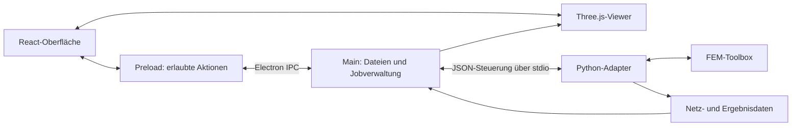

# Femantis Desktop – Electron-Oberfläche und 3D-Ansicht

Stand: 12.10.2026 · Status: Architektur- und Umsetzungsplanung

Umsetzung begonnen am 13.10.2026. Der erste Desktop-/Viewer-Schnitt steht in [IMPLEMENTATION.md](IMPLEMENTATION.md), der datierte aktuelle Überblick in [PROJECT_STATUS.md](PROJECT_STATUS.md); diese Datei bleibt die Planungsbaseline.

## 1. Ziel und geprüfte Grundlage

Femantis Desktop soll eine lokal nutzbare FEM-Arbeitsoberfläche werden: Netz öffnen, Bauteil und Diskretisierung räumlich prüfen, Materialien und Randbedingungen bearbeiten, ein Modell berechnen und Ergebnisse mit Einheiten und Herkunft auswerten.

Das lokale Projekt war bei Beginn leer und kein Git-Repository. Geprüfte Grundlage ist das private Repository [maschin96/FEM-Toolbox](https://github.com/maschin96/FEM-Toolbox) auf `main`, Commit `baae07f088a87ce6e256af3c5855a3b110d0f17a`. `pyproject.toml` und README nennen **v1.4.0** mit CPython **3.11–3.13**. Diese Planung verändert die Toolbox nicht.

| Vorhandene Grundlage | Bedeutung für die Oberfläche |
|---|---|
| `Mesh`: Punkte, Tet4/Tet10, Triangle3/Triangle6, externe IDs und Tags | Netz und Auswahl ohne Verlust der ursprünglichen Zuordnung übernehmen |
| `volume_sets` und `facet_sets`, einschließlich Überlappungen | Projektbaum, Materialregionen und Flächenauswahl |
| `read_gmsh`, `read_vtu`, `write_vtu` | Import vorhandener Netze und Export; `read_vtu` liefert das Netz, Ergebnisarrays müssen separat gelesen werden |
| `inspect_boundary_topology` mit Eigentümerelement, Normalen und Gruppen | Bauteilaußenfläche ableiten, auch wenn Randdreiecke fehlen |
| `Model.from_file`, `Model(mesh=..., document=...)`, `to_document`, `solve` | Bestehende TOML-Verträge für Modelle verwenden |
| Schema-/Randbedingungsprüfung bei Modellkonstruktion | Fehler vor dem Rechnen mit betroffenen Eingabefeldern anzeigen |
| Ergebnisbündel aus VTU und JSON mit Provenienz | Rohfelder, Bilanzen, aktive Knoten und Versionsinformationen auswerten |
| Statische Matplotlib-Feldvisualisierung | Referenz für Feldbedeutung und Zuordnung; interaktiver Viewer wird neu entwickelt |

Wichtige Grenzen des Bestands: keine gemischten Tet4-/Tet10-Netze; Tet10 ist geradkantig. TOML/Model verwendet SciPy; optionales PETSc an direkten Python-APIs ist kein vorhandener TOML-Schalter. Der Matplotlib-Adapter unterstützt nur stationäre, reelle Tet4-Felder. Seine Grenzen sind nicht automatisch Grenzen des neuen Viewers, zusätzliche Viewer-Funktionen benötigen jedoch eigene Nachweise.

## 2. Umfang und Reihenfolge

**Erstes benutzbares Ergebnis:** Eine Electron-App öffnet ein vorhandenes Gmsh-Netz, zeigt dessen Bauteilaußenfläche und FEM-Netz, erlaubt die Auswahl benannter Gruppen und speichert die Ansicht in einem Projekt.

**Erste vollständige Version:** Zusätzlich stationäre Wärme, lineare Elastizität und Elektrostatik über die Model-API bearbeiten und ausführen; anschließend Temperatur, Verschiebung, Potential und verfügbare Zellfelder anzeigen. Tet4 ist der erste durchgängige Berechnungs- und Ergebnisfall. Tet10-Netzansicht gehört zur Viewer-Stufe; Tet10-Feldinterpolation erhält ein separates Abnahmegate.

**Weitere Ausbaustufen:** Piezoelektrizität und Thermopiezoelektrizität, Tet10-Felder, Zeit-/Frequenzdaten, CAD-Import und Netzgenerierung. Thermomechanik bekommt einen gesonderten Adapter für den vorhandenen Python-Workflow, soweit sie nicht durch den jeweiligen Model-Vertrag abgebildet ist.

Die GUI ist ein neuer, durch diesen Auftrag angestoßener Produktumfang. Ältere Toolbox-Roadmaps schließen GUI/CAD ausdrücklich aus; daraus folgt kein Hindernis für diese separate Planung. Die GUI erhält eine eigene Entwicklungslinie und ist keine Voraussetzung für die geplante Python-Namensmigration.

## 3. Bedienkonzept

Die Oberfläche folgt dem Arbeitsablauf **Projekt → Netz → Physik → Materialien → Randbedingungen → Prüfen → Berechnen → Ergebnisse**. Ein bereits vorhandener TOML-Fall kann direkt geöffnet werden.

```text
┌─────────────────────────────────────────────────────────────────────────┐
│ FEMantis  Projekt öffnen  Speichern   Prüfen   Berechnen   Abbrechen      │
├──────────────────┬───────────────────────────────────┬──────────────────┤
│ Projektbaum      │ Bauteil | Netz | Ergebnisse        │ Eigenschaften    │
│                  │                                   │                  │
│ Bauteil/Netz     │          Interaktive 3D-Ansicht     │ Auswahl          │
│ Volumengruppen   │                                   │ Material         │
│ Flächengruppen   │  Drehen · Zoomen · Verschieben     │ Randbedingung    │
│ Materialien     │                                   │ Einheit/Wert     │
│ Randbedingungen │  Achsen · Standardansichten        │ Netzinformation  │
│ Berechnungen    │  Sichtbarkeit · Kanten · Knoten    │ Feld/Komponente  │
│ Ergebnisse      │                                   │ Farbskala        │
├──────────────────┴───────────────────────────────────┴──────────────────┤
│ Meldungen | Modellprüfung | Berechnung | Bilanzen                        │
├─────────────────────────────────────────────────────────────────────────┤
│ Projektstatus · Einheit · Knoten/Elemente · Toolbox-Version              │
└─────────────────────────────────────────────────────────────────────────┘
```

- **Projektbaum:** Bauteil, Netzgruppen, Materialzuordnungen, Randbedingungen und einzelne Berechnungsläufe. Gruppen einzeln ein-/ausblenden; Auswahl in Baum und Viewer synchronisieren.
- **3D-Ansicht:** größte Arbeitsfläche, unverzerrte Proportionen, Achsenanzeige und Ansichten von vorn/oben/seitlich/isometrisch; Funktion „Alles einpassen“.
- **Eigenschaften:** nur passende Eingaben zur gewählten Physik und Auswahl. Materialtensoren mit Einheiten, Achsen und Komponentenreihenfolge; einfache isotrope Eingabe zuerst.
- **Meldungen:** Ursache, betroffene Zell-/Knoten-ID oder TOML-Feldpfad und konkrete Korrektur. Fehleranklick öffnet die betroffene Eingabe oder Auswahl.
- **Berechnungsstatus:** zunächst Phasen „Prüfen“, „Zusammenstellen/Berechnen“, „Exportieren“; Prozentwerte nur bei echten Fortschrittsereignissen. Eine endliche Rechenlösung allein wird nicht als physikalische Validierung bezeichnet.
- **Bedienbarkeit:** Tastaturfokus, skalierbare Seitenleisten, Zahlen mit Einheiten, eindeutige aktive Auswahl und Warnung bei ungespeicherten Änderungen. Deutsche Oberfläche; technische Feldnamen zusätzlich sichtbar.

### Gestaltung

Den vorhandenen [Femantis-CI-Leitfaden](https://github.com/maschin96/FEM-Toolbox/blob/baae07f088a87ce6e256af3c5855a3b110d0f17a/Doc/75_FEMANTIS_CORPORATE_IDENTITY.md) übernehmen: Petrol `#0B1F2A` für Navigation und Text, Grün `#2ECC71` für Aktionen mit Petroltext, Blau `#4B8BBE` für ergänzende Akzente, Weiß und `#E5E7EB` für Arbeitsflächen und Trennlinien. Inter mit Lizenzdatei bündeln oder zunächst Systemschrift verwenden. Wissenschaftliche Farbskalen richten sich nach den Feldern, nicht nach der Markenfarbe. Produktionsfertige Logo-/Icondateien sind im Quellbestand noch ein Backlog.

## 4. Technische Architektur

**Empfehlung:** Electron + TypeScript + React + Vite für die Desktopoberfläche, Three.js als gekapselte Viewer-Komponente und ein separater Python-Prozess als Toolbox-Adapter. Electron Forge für Paketierung zunächst evaluieren; konkrete Versionen erst beim Projektstart kompatibel auswählen und fixieren.

React organisiert Formulare und Zustände. Three.js bleibt hinter einer eigenen Schnittstelle, sodass Fachlogik nicht an Szenenobjekte gebunden wird. Für den anfänglichen Oberflächen-/Netzviewer genügt ein direkter Three.js-Adapter. Falls später umfangreiches wissenschaftliches Postprocessing nötig wird, VTK-basiertes Processing gesondert bewerten.



Electron trennt Main, Renderer und Preload; native Aktionen werden über definierte IPC-Aufrufe erreichbar. Rechenarbeit läuft außerhalb des Main- und Renderer-Prozesses, damit Fenster und Ansicht bedienbar bleiben. Grundlage: [Electron-Prozessmodell](https://www.electronjs.org/docs/latest/tutorial/process-model) und [IPC-Dokumentation](https://www.electronjs.org/docs/latest/tutorial/ipc).

### Verantwortlichkeiten

| Baustein | Aufgaben |
|---|---|
| Renderer | Bedienung, Projektansicht, Viewer, Formulare, Anzeige von Diagnosen |
| Preload | Typisierte, eng begrenzte Methoden; keine allgemeine Shell-/Dateisystem-API |
| Main | Fenster, native Dialoge, Projektdateien, Jobstart/-ende, Adapter-Lebenszyklus |
| Python-Adapter | Import, Topologie, Model-Prüfung/-Lauf, Feldmetadaten und bestehende Exporte |
| Web Worker | Bei Bedarf Aufbereitung großer bereits geladener Viewer-Daten |
| Toolbox | Numerische Modelle, Materialien, Solver und Provenienz |

`contextIsolation: true`, `nodeIntegration: false`, Renderer-Sandbox, restriktive Content Security Policy und validierte IPC-Sender/-Eingaben einplanen. Lokale App-Inhalte laden. Der Main startet ausschließlich den konfigurierten Adapter ohne Shell-Interpolation. Das entspricht den [Electron-Sicherheitsempfehlungen](https://github.com/electron/electron/blob/main/docs/tutorial/security.md).

### Python-Anbindung

Zunächst lokal verwaltete Python-Umgebung mit festgelegter Toolbox-Version. Der Adapter importiert `fem_toolbox`, solange die Migration nicht veröffentlicht ist. Keine Kopie oder Neuberechnung der Solver in JavaScript.

Steuerung über versionierte JSON-Nachrichten auf stdin/stdout, Diagnoselog auf stderr. Aktionen: `capabilities`, `importMesh`, `validateModel`, `solveModel`, `loadResult`. Jede Anfrage hat eine ID; Ereignisse haben eine Job-ID. Dies sind **neu zu implementierende Adapteraktionen**, keine bereits vorhandene Toolbox-CLI. Fehler tragen Kategorie, Feldpfad, Entitäts-IDs und verständlichen Text.

Ein Capability-Handshake prüft Python-, Toolbox- und Protokollversion sowie unterstützte Modi/Schemas. Zunächst ein rechenintensiver Job gleichzeitig; ein eigener Jobprozess ermöglicht Abbruch durch Beenden des Prozessbaums. Nur vollständig exportierte Läufe werden als abgeschlossen angezeigt. Ein Prozessabbruch ist keine Fortsetzungsmöglichkeit des Solvers.

## 5. Bauteil und Netz in 3D

### Bauteilansicht

Im ersten Umfang bedeutet „Bauteil“ die aus dem FEM-Netz abgeleitete Außenhaut. Sie wird schattiert, mit optionalen Kanten und Transparenz dargestellt. Das ist eine diskrete Netzgeometrie, kein vorhandenes CAD-Volumen. Originalgeometrie aus STEP/BREP folgt mit dem CAD-Arbeitspaket.

Außenflächen über `inspect_boundary_topology` bestimmen, innere gemeinsame Flächen entfernen und Normalen aus der validierten Topologie übernehmen. Vorhandene Randgruppen erhalten ihre IDs. Eine abgeleitete Fläche ohne expliziten Triangle-Eintrag darf angezeigt werden; sie ist dadurch noch kein vorhandener Randbedingungssatz. Neue Flächensätze benötigen einen eigenen Editor- und Persistenzvertrag.

### Netzansicht

- Oberflächenelemente und Kanten als Standard; Knoten optional als Punktdarstellung.
- Volumenelementkanten nur auf Wunsch und bei großen Netzen auf Auswahl begrenzen.
- Gruppen farbig markieren, Auswahl hervorheben, externen Identifier und internen Index getrennt anzeigen.
- Tet4 und Tet10 getrennt unterstützen. Triangle6 für die Darstellung in Teilflächen unterteilen und die Rückabbildung auf das Originalelement behalten.
- „Alle Netzknoten“ und „Nur aktive Volumenknoten“ unterscheiden, insbesondere bei Ergebnissen.
- Netzstatistik: Punkte, Elementtyp, Zellen, Gruppen, Bounding Box und verfügbare Qualitätsdiagnosen. Keine ungeprüften allgemeinen Qualitätsgrenzen erfinden.

### Auswahl und Datenzuordnung

Jedes sichtbare Dreieck besitzt eine Rückabbildung zu Eigentümerelement, ursprünglicher Fläche falls vorhanden und Gruppen. Knotendarstellung behält die ursprüngliche Knotenabbildung. Externe 64-Bit-IDs als Strings übertragen, damit JavaScript keine großen IDs rundet; GPU-Indizes bleiben getrennte dichte Indizes.

Auswahlmodi: Gruppe, Fläche, Element und Knoten. Zunächst Oberfläche/Gruppe; Boxauswahl und Auswahl innerer Elemente später. Unsichtbare Objekte werden nicht versehentlich ausgewählt. Three.js liefert [Raycasting für Picking](https://threejs.org/docs/pages/Raycaster.html) und [OrbitControls](https://threejs.org/docs/pages/OrbitControls.html) für Drehen, Zoomen und Verschieben; die fachliche Rückabbildung ist eigene Arbeit.

## 6. Ergebnisansicht und fachliche Korrektheit

Felder aus dem vorhandenen Export bzw. Ergebnisobjekt verwenden. Das UI zeigt Größe, Komponente, Einheit, Knoten-/Zellbezug und Auswerteort. Ergebnisbündelschema 1 und 2 von Model-Schema 1/2/3 und Desktop-Projektschema unterscheiden.

| Fall | Erste Ansichten |
|---|---|
| Wärme | Temperatur, Komponenten/Betrag des Wärmestroms, Leistungsbilanz |
| Elastizität | Verschiebungskomponenten/-betrag, Spannungs-Komponenten, Reaktionen |
| Elektrostatik | Potential, E-/D-Feld-Komponenten/-betrag, Ladungsbilanz |
| Später Piezo/Thermopiezo | gekoppelte Felder, Elektrodenwerte, getrennte Energie-/Bilanzgrößen |

Bei nodalen Tet4-Werten lineare Interpolation auf dem Darstellungsdreieck anbieten; im Inspector Rohknotenwerte zeigen. Vektorbetrag zunächst pro Knoten auswerten, danach visuell interpolieren und diese Reihenfolge dokumentieren. Die statische Matplotlib-Flächenmittelung ist ein anderer Darstellungsmodus und darf nicht als identisches Bildresultat behauptet werden.

Zellwerte ohne Glättung auf die Außenflächen des Eigentümerelements übertragen. Tet10-Schwerpunktwerte bleiben ausdrücklich Schwerpunktwerte; keine scheinbar hochaufgelösten Spannungen oder Flüsse daraus erzeugen. Für Tet10-Knotenfelder quadratische Formfunktionen verwenden und Unterteilung/Interpolation prüfen. Inaktive/paddende Werte maskieren; sie sind keine physikalischen Nullwerte.

Farbskala mit Einheit, einstellbaren Grenzen und Kennzeichnung abgeschnittener Werte; ein konstantes Feld erhält eine nachvollziehbare Skala. Bei Vergleichen gemeinsame Grenzen anbieten. Verformungsansicht mit explizitem Faktor `x_Anzeige = x + Faktor · u`; Netz und Rohwerte bleiben unverändert. Einheitensystem intern SI, Anzeigeumrechnung ohne Änderung der Solverdaten.

Ein späterer Schnitt muss Felder aus den Volumenelementen auswerten. Reines Abschneiden der Außenhaut ergibt eine offene Hülle und darf nicht als gefüllter FEM-Querschnitt bezeichnet werden. Zeit-, Eigenmode- und komplexe Harmonikansichten bekommen eigene Metadaten- und Testverträge.

## 7. Modelle, Projekte und Speicherung

Bestehende `.toml`-Modellformate bleiben maßgeblich. UI-Formulare erzeugen oder bearbeiten denselben Vertrag, erhalten noch nicht grafisch bearbeitbare unterstützte Einträge und melden unbekannte/inkompatible Schemas. Konstruktion von `Model` ist der verbindliche Preflight; es gibt derzeit keinen zugesagten allgemeinen `Model.preflight()`-Aufruf.

Vorgeschlagene Desktop-Projektstruktur:

```text
beispielprojekt/
  project.json          # Desktop-Schema, Modelle, Ansicht, zuletzt gewählter Lauf
  models/fall-01/
    case.toml           # Originaler Toolbox-Modellvertrag
    mesh.msh            # Innerhalb des Modellverzeichnisses
  runs/<lauf-id>/
    case.toml           # Unveränderlicher Eingabesnapshot
    mesh.msh
    result.vtu
    result.json
    adapter.log
```

Relative Netzpfade müssen gemäß Model-Vertrag innerhalb des Modellverzeichnisses bleiben. Import eines Falls kopiert benötigte Eingaben bewusst in das Projekt; fehlende Dateien werden vor dem Lauf gemeldet. Ausgabeverzeichnisse vorher anlegen und jeden Lauf mit neuem Präfix exportieren, da `export_result_bundle` nicht überschreibt. Speichern über temporäre Datei und atomaren Austausch; manuelles Überschreiben fremder Dateien benötigt eine bewusste Zielwahl.

Jeder Lauf verweist auf die tatsächlich gerechnete Modell-/Netzrevision. Änderungen nach einem Lauf markieren dessen Ergebnisse als zu einem früheren Stand gehörig. Desktop-Projektmetadaten, Viewer-Bufferschema und Toolbox-Schemas getrennt versionieren. Keine Umbenennung persistierter `fem_toolbox:*`-Felder im Zuge der Produktgestaltung.

Das offene Toolbox-[Issue #255](https://github.com/maschin96/FEM-Toolbox/issues/255) plant den gemeinsamen Projekt-/Befehlsvertrag und schließt GUI ausdrücklich aus. Seine Entscheidungen für Pfade, Läufe und Ausgabe mit dieser Desktop-Schicht abstimmen; die geplante CLI ist keine Voraussetzung für den ersten Python-Adapter.

## 8. Große Netze und Datenübertragung

Steuerdaten als JSON, Geometrie/Felder als binäre Arrays mit Manifest: Typ, Form, Byte-Reihenfolge, Revision und Feldzuordnung. Kein millionenfacher JSON-Knotenexport. Main/Adapter lesen nur erwartete projektbezogene Artefakte; der Renderer erhält Daten, keinen beliebigen Dateizugriff.

Double-Präzision im Fachmodell behalten; für die GPU um einen lokalen Ursprung zentrieren und als Float32 übertragen. Originalkoordinaten für Inspector, Messung und Rückabbildung bewahren. [Three.js BufferGeometry](https://threejs.org/docs/pages/BufferGeometry.html) unterstützt Punkte, Linien und Meshes über Pufferattribute.

Oberflächen, Kanten und Punkte bündeln statt ein Szenenobjekt pro Element erzeugen. Nach Bedarf rendern, Geometrieaufbereitung auslagern, Knotenlabels auf Auswahl begrenzen, GPU-Ressourcen beim Schließen freigeben. Vereinfachung nur als klar markierte Anzeigeoption; Auswahl und Solver arbeiten mit den Originaldaten.

**Vorläufiges Benchmarkziel, noch kein Nachweis:** Auf einem dokumentierten Referenzgerät ein repräsentatives Netz mit 100.000 Tet4-Zellen anzeigen, bei typischer Drehung mindestens 30 FPS erreichen und die Oberfläche während eines Solverjobs bedienbar halten. Vor Umsetzung mit realen Toolbox-Fällen Speicher, Oberflächenzahl, Ladezeit und Picking messen; bei 1 Million Zellen zunächst Grenzen ermitteln, keine Leistung zusagen.

## 9. Geplante Codeorganisation

```text
src/main/              Fenster, Projektdateien, IPC, Jobs
src/preload/           erlaubte Desktop-API
src/renderer/          React-App, Projektbaum, Formulare, Ergebnisse
src/renderer/viewer/   Szene, Kamera, Layer, Picking, Felddarstellung
src/shared/            Protokolltypen und Schema-/Capability-Verträge
backend/               Python-Adapter und Toolbox-Abhängigkeit
tests/                 fachliche Adapter-/Viewer-Tests und Desktop-Abläufe
Doc/                   Entscheidungen, Nutzerabläufe, Abnahmen
```

Toolbox als versionierte Abhängigkeit, keine kopierte `src/fem_toolbox`-Implementierung. Offline-Betrieb nach Installation als Ziel. Zur ersten Entwicklung eine konfigurierte Python-Umgebung verwenden; für eine veröffentlichbare Desktopversion eine mitgelieferte Runtime evaluieren und auf sauberen Zielsystemen prüfen. Wheel, NumPy/SciPy, native Bibliotheken und Lizenzen pro Plattform berücksichtigen.

Plattformstrategie: macOS als erste lokale Entwicklungsplattform; Windows und Linux als geplante Ziele. Tatsächliche CPU-Architektur des Entwicklungsgeräts beim Start ermitteln. Installations-/Signierungsnachweise je Zielplattform sind eigene Freigabearbeiten; plattformübergreifender Electron-Code allein belegt keine vollständige Auslieferbarkeit.

## 10. Arbeitspakete mit Abnahmegates

Die Kennungen D0–D7 sind lokale Planungspakete, keine existierenden GitHub-Issues oder Toolbox-Milestones. Vor ausführbarer Umsetzung passende Issues und Integrationsziele festlegen.

| Paket | Inhalt | Überprüfbares Ergebnis | Abhängigkeit |
|---|---|---|---|
| D0 – Vertragsprobe | Referenzfälle, Capability-/Buffervertrag, Original-IDs, Paketversion | Ein Tet4- und ein Tet10-Netz samt Gruppen exportiert; Vergleich mit Python-Arrays; erster Leistungsbaseline | Planung |
| D1 – Desktopgerüst | Electron, React, Main/Preload, Layout, Projekte | App startet lokal; Projekt speichern/öffnen; definierte IPC-Aktionen; Python-Handshake und verständlicher Fehler bei fehlender Runtime | D0 |
| D2 – 3D-Viewer | Gmsh-/VTU-Netz, Außenhaut, Kanten, Knoten, Kamera, Gruppen/Picking | Tet4-/Tet10-Bauteil und Netz sichtbar; Auswahl verweist auf korrekte Original-ID; Netz ohne Randdreiecke sichtbar | D1 |
| D3 – Modelleditor | Stationäre Wärme, Elastizität, Elektrostatik; vorhandene Gruppen zuordnen | TOML-Roundtrip; Einheiten korrekt; fehlende Referenz/Randbedingungskonflikte vor Lauf verständlich melden | D2 |
| D4 – Jobs und Tet4-Ergebnisse | Prüfen, rechnen, abbrechen, Ergebnisbündel, Felder/Bilanzen | Drei vorhandene Einzelfeldrezepte aus sauberem Projekt ausführen; numerische Parität; UI bedienbar; Laufrevision und Ergebnis stimmen überein | D3 |
| D5 – Erweiterte Physik | Piezo-/Thermopiezoformulare, Elektroden, Tet10-Felder | Vorhandene Rezepte mit Ladungs-/Energiebilanzen; Schwerpunktkennzeichnung und quadratische Anzeige geprüft | D4 |
| D6 – CAD und Meshing | STEP/BREP-Import, Tessellierung, externer Mesher, Gruppenzuordnung | CAD-Flächenidentität bis FEM-Randgruppen nachvollziehbar; Einheiten und neu erzeugtes Netz geprüft | D4; separater CAD-Vertrag |
| D7 – Serien und Auslieferung | Zeit-/Frequenz-/Modenansichten, Zielplattformen, Installationspakete | Serienwerte korrekt ausgewählt; komplexe Größen explizit; Runtime/Toolbox auf sauberem Zielsystem verfügbar | D5; Serien- und Releasevertrag |

**Empfohlener erster Umsetzungsschnitt: D0–D2.** Danach ist die zentrale Anforderung „Bauteil und Netz interaktiv in Electron darstellen“ benutzbar. D3–D4 machen daraus einen vollständigen FEM-Arbeitsablauf. CAD-Import blockiert diesen ersten Schnitt nicht. Eine seriöse Kalenderschätzung folgt nach D0, wenn Referenznetze und Paketierung vermessen sind.

### CAD-Erweiterung konkret

Für STEP/BREP einen passenden Open-Cascade-Adapter prüfen; vorhandene Toolbox-Netzimporte sind kein CAD-Reader. Für Volumenmeshing Gmsh als separate Integration evaluieren. STL kann als triangulierte Geometrie angezeigt werden, besitzt aber nicht automatisch semantische CAD-Flächen oder ein rechenfähiges Volumennetz. Remeshing erzeugt neue Netzrevisionen; alte knotenbasierte Randbedingungen dürfen nicht ungeprüft übernommen werden.

## 11. Prüf- und Abnahmeplan

Neue ausführbare Funktionen nach Red–Green–Refactor entwickeln; bei Toolbox-Beiträgen deren `AGENTS.md` und wissenschaftliche Verifikationsregeln anwenden. Für diese reine Planung sind keine künstlichen Laufzeittests erforderlich.

| Prüfung | Unabhängige Erwartung |
|---|---|
| Außenhaut | Zwei Tet4 mit gemeinsamer Fläche erzeugen sechs Außenflächen; innere Fläche unsichtbar |
| Flächen/Picking | bekannte äußere Fläche liefert Eigentümerelement und importierte ID, auch ohne Triangle-Eintrag |
| Tet10 | sechs Flächenknoten korrekt zugeordnet; lineares Referenzfeld reproduziert, quadratisches Feld gegen Formfunktionen geprüft |
| Gruppen/IDs | überlappende Gruppen bleiben erhalten; 64-Bit-ID ohne Rundung; interne/externe IDs nicht vertauscht |
| Netzfehler | Hybridnetz, ungültige Indizes, nichtkonforme Flächen und entartete Zellen mit konkreter Diagnose |
| Modell | TOML-Feldwerte und Einheiten nach Speichern/Öffnen erhalten; bekannter Randbedingungskonflikt abgelehnt |
| Felder | Rohwertprobe entspricht Ergebnisarray; inaktive Knoten maskiert; Zellwerte nicht geglättet; Schwerpunktfelder korrekt beschriftet |
| Solver-Parität | UI-Aufruf und unverändertes Python-Rezept mit gleichen Eingaben liefern gleiche Rohfelder und Bilanzen innerhalb fachlich begründeter Toleranzen |
| Job-Lebenszyklus | fehlende Runtime, Crash, Abbruch und Exportfehler führen nicht zu einem scheinbar erfolgreichen Lauf |
| Projekte | relative Pfade gültig; neuer Lauf überschreibt keinen alten; veraltetes Ergebnis nach Modelländerung markiert |
| Desktop/Performance | echte Desktop-Abläufe, saubere Installation je Zielplattform, dokumentierte Viewer-Ladezeit/FPS/Speicher |

Geplante Werkzeuge: TypeScript-Prüfung, gezielte Frontend-/Protokolltests, pytest für Adapter, Desktop-End-to-End-Tests mit Playwright nach Kompatibilitätsprüfung. Screenshots ergänzen Datenprüfungen für Auswahl, Netzsichtbarkeit, Farbskalen und Einheiten; sie ersetzen keine numerische Verifikation.

Die GUI verändert keine FEM-Operatoren. Neue Solver-Konvergenznachweise sind bei unverändertem Kern nicht automatisch nötig; Adapterparität und korrekte Darstellung schon. CAD/Meshing, neue Interpolation und Schnittberechnungen erhalten zusätzliche fachliche Prüfungen.

## 12. Entscheidungen und verbleibende Klärungen

Festgelegt als Planungsbasis: separates Desktopprojekt, Electron/React/TypeScript, gekapselter Three.js-Viewer, lokaler Python-Adapter, vorhandene Model- und Exportverträge, Femantis-Gestaltung, Viewer vor vollständigem Editor.

Vor D0 konkret festlegen: repräsentative Netzgrößen und Geräte, Zielpriorität Windows/Linux, Toolbox-Bezugsquelle für reproduzierbare Installation und GitHub-Ziel des Desktopprojekts. Diese offenen Punkte verhindern die vorliegende Planung nicht.

Vor D6: benötigte CAD-Formate, Geometriekern, Mesher-Lizenzen/Verteilung, stabile Flächenidentität und Remeshing-Verhalten. Vor Veröffentlichung: Runtime-Paketierung, Plattformprüfung, finale Icons und Signierung. Die v2.0-Namensmigration ist eine eigenständige Toolbox-Entscheidung; Adapter und gespeicherte Daten respektieren ihren Kompatibilitätsvertrag.

## 13. Quellen und Prüfung dieser Planung

Toolbox-Inhalte wurden authentifiziert und lesend über GitHub geprüft. Links beziehen sich auf den festgehaltenen Commit, soweit möglich; der Zugriff erfordert Berechtigung für das private Repository.

- [README und Umfang v1.4.0](https://github.com/maschin96/FEM-Toolbox/blob/baae07f088a87ce6e256af3c5855a3b110d0f17a/README.md), [Paketkonfiguration](https://github.com/maschin96/FEM-Toolbox/blob/baae07f088a87ce6e256af3c5855a3b110d0f17a/pyproject.toml).
- [Mesh-Datenmodell](https://github.com/maschin96/FEM-Toolbox/blob/baae07f088a87ce6e256af3c5855a3b110d0f17a/src/fem_toolbox/mesh/model.py), [Randtopologie](https://github.com/maschin96/FEM-Toolbox/blob/baae07f088a87ce6e256af3c5855a3b110d0f17a/src/fem_toolbox/mesh/topology.py), [I/O-Adapter](https://github.com/maschin96/FEM-Toolbox/blob/baae07f088a87ce6e256af3c5855a3b110d0f17a/src/fem_toolbox/io/meshio_adapter.py).
- [Model-Schema](https://github.com/maschin96/FEM-Toolbox/blob/baae07f088a87ce6e256af3c5855a3b110d0f17a/Doc/21_MODEL_SCHEMA.md), [aktueller Model-Code](https://github.com/maschin96/FEM-Toolbox/blob/baae07f088a87ce6e256af3c5855a3b110d0f17a/src/fem_toolbox/model.py), [öffentlicher API-Vertrag und spätere Erweiterungen](https://github.com/maschin96/FEM-Toolbox/blob/baae07f088a87ce6e256af3c5855a3b110d0f17a/Doc/29_PUBLIC_API_CONTRACT.md).
- [Ergebnisbündel einschließlich Tet10-Erweiterungen](https://github.com/maschin96/FEM-Toolbox/blob/baae07f088a87ce6e256af3c5855a3b110d0f17a/Doc/24_RESULT_BUNDLE.md), [statische Feldvisualisierung](https://github.com/maschin96/FEM-Toolbox/blob/baae07f088a87ce6e256af3c5855a3b110d0f17a/Doc/62_FIELD_VISUALIZATION.md).
- [Produktvision](https://github.com/maschin96/FEM-Toolbox/blob/baae07f088a87ce6e256af3c5855a3b110d0f17a/Doc/13_PRODUCT_VISION.md), [Namens-/Persistenzvertrag](https://github.com/maschin96/FEM-Toolbox/blob/baae07f088a87ce6e256af3c5855a3b110d0f17a/Doc/77_FEMANTIS_MIGRATION_CONTRACT.md), [Entwicklungsrichtlinien](https://github.com/maschin96/FEM-Toolbox/blob/baae07f088a87ce6e256af3c5855a3b110d0f17a/AGENTS.md).
- [Electron Forge: Vite/TypeScript](https://www.electronforge.io/templates/vite-+-typescript); Electron-/Three.js-Primärquellen stehen zusätzlich bei den jeweiligen Architekturentscheidungen.

Geprüft: Repository-/Versionsbezug, benannte Einstiegspunkte, Grenzen von Mesh/Model/Export, CI-Farben, Projekt-/Migrationsbezug und lokale Dokumentverweise. Keine Laufzeit-, Leistungs-, Solver- oder Installationsprüfung ausgeführt; es wurde ausschließlich geplant. Die Arbeitspakete und Leistungsziele sind Vorschläge, keine bereits implementierten oder abgenommenen Funktionen.
